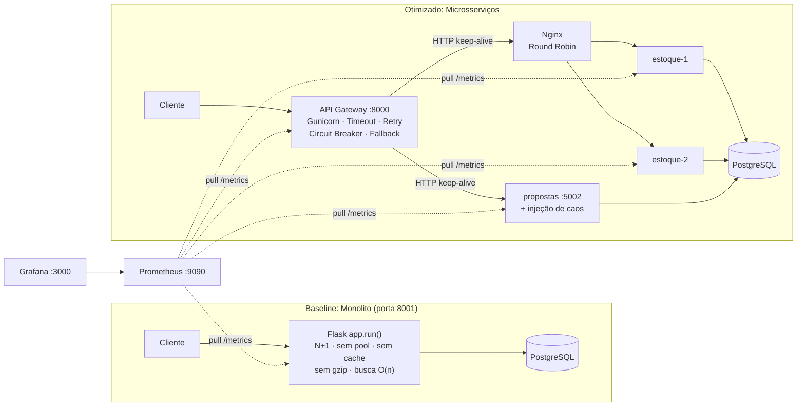

# AutoFlow: Engenharia de Performance, Escala e Resiliência

Sistema para **lojas de veículos**: estoque de carros, anúncios com detalhes de cada
veículo e propostas de compra. O projeto mostra a evolução de uma aplicação
**monolítica e ingênua** até uma arquitetura de **microsserviços observável,
escalável, otimizada e resiliente**. Cada ganho é comprovado com Prometheus,
Grafana e Locust.

> Trabalho da disciplina de Performance e Escalabilidade de Sistemas (Prof. Clayton Valdo).

Stack: Python 3.12 · Flask · PostgreSQL · Gunicorn · Nginx · Prometheus · Grafana · Locust · Docker Compose

---

## 1. Arquitetura



| Componente | Responsabilidade |
|---|---|
| `servicos/monolito` | Versão inicial com todos os gargalos (baseline) |
| `servicos/gateway` | Porta de entrada única; junta estoque + propostas; resiliência |
| `servicos/estoque` | Veículos e marcas (2 réplicas, eixo X do Cubo AKF) |
| `servicos/propostas` | Propostas de compra + endpoints de caos |
| `comum/` | Métricas, banco com pool, cache LRU/TTL, gzip/Cache-Control, seed, placas |

Dados de exemplo: 16 marcas, 2.000 veículos (placas Mercosul) e 20.000 propostas.

---

## 2. Como rodar (Docker, qualquer sistema operacional)

Pré-requisito: Docker Desktop (Windows/Mac) ou Docker Engine + Compose (Linux).

```bash
docker compose up -d --build        # sobe tudo (o seed popula o banco sozinho)
docker compose ps                   # tudo "running"; o seed termina com "exited (0)"
```

| Endereço | O quê |
|---|---|
| http://localhost:8001/api/veiculos | Monolito (baseline) |
| http://localhost:8000/api/veiculos | Gateway (otimizado) |
| http://localhost:8000/api/veiculos/7 | Anúncio de um veículo + propostas |
| http://localhost:8000/api/resiliencia | Estado dos circuit breakers |
| http://localhost:5002/caos/status | Estado do caos |
| http://localhost:9090/targets | Prometheus: os 5 alvos devem estar **UP** |
| http://localhost:3000 | Grafana (admin/admin). Dashboard **AutoFlow** já vem provisionado |
| http://localhost:8089 | Locust (interface web) |

Para derrubar tudo: `docker compose down` (use `-v` para apagar o banco também).

> **Windows:** rode os comandos com `curl` e `grep` deste README no **Git Bash** (no VS Code:
> Terminal → seta ao lado do + → Git Bash). No PowerShell o `grep` não existe e o `curl` é outro programa.

---

## 3. Roteiro de demonstração, etapa por etapa

### Etapa 1: Observabilidade
- Código: `comum/metricas.py` (Counter, Gauge e Histogram) e `/metrics` em cada serviço.
- Métricas de negócio: veículos visualizados por marca, propostas por forma de
  pagamento, valor total ofertado (R$) e ticket médio das propostas.
- Coleta: `prometheus/prometheus.yml` (modelo pull, a cada 5 s).
- Dashboard: `grafana/dashboards/autoflow.json`, com PromQL usando `rate()`,
  `sum()` e `histogram_quantile()` em painéis Time Series, Stat e Gauge.

### Etapa 2: Escala
- Monolito (`:8001`) contra Gateway + 2 serviços (`:8000`), com rotas idênticas.
- Escala horizontal: `estoque-1` e `estoque-2` atrás do Nginx (`nginx/nginx.conf`).
  O painel "RPS por réplica do Estoque" mostra a carga dividida meio a meio.
  Para usar Menor Conexão, descomente `least_conn;` e rode `docker compose restart nginx`.
- Prova rápida: `curl -sI localhost:8080/veiculos/1 | grep X-Upstream` (rode várias vezes).

### Etapa 3: Dados
- **N+1 → JOIN** (`servicos/estoque/app.py`):
  ```bash
  curl -sI "localhost:8080/veiculos?modo=n1"   | grep X-DB-Queries   # 51
  curl -sI "localhost:8080/veiculos?modo=join" | grep X-DB-Queries   # 1
  ```
  No Grafana (painel "Queries SQL por requisição"), rode o Locust com N+1 e depois sem:
  ```bash
  docker compose run --rm -e MODO_CONSULTA=n1 locust -f /mnt/locust/locustfile.py --headless -u 50 -r 10 -t 10m --host http://gateway:8000
  ```
  Em seguida, pare (Ctrl+C) e rode de novo sem `-e MODO_CONSULTA=n1`. A linha cai de cerca de 51 para 1.
  (Os comandos `--headless` não usam a porta 8089, então não conflitam com o Locust da interface web.)
- **Batching**: o gateway busca o resumo de propostas (interessados e maior oferta)
  de todos os veículos da página em **uma** chamada (`/propostas/resumo?ids=...`),
  em vez de fazer N chamadas HTTP.
- **Connection pooling**: `comum/db.py` (`ThreadedConnectionPool`) e `requests.Session`
  com `HTTPAdapter` no gateway. O painel "Conexões físicas abertas/s" compara o monolito
  (uma conexão por query) com os microsserviços (praticamente zero).

### Etapa 4: Rede, código e plataforma
- **Gzip + Cache-Control**: `comum/otimizacoes.py`
  ```bash
  curl -s -H "Accept-Encoding: gzip" -D - -o /dev/null localhost:8000/api/veiculos
  # Content-Encoding: gzip | X-Tamanho-Original ~12,8 KB x Content-Length ~2,3 KB (cerca de 82% menor)
  # Cache-Control: public, max-age=30
  ```
- **O(1) vs O(n)**: `/veiculos/busca?placa=` usa um `dict` (hash). Use `&algoritmo=linear`
  para a busca em lista. O monolito ainda carrega o estoque inteiro a cada busca.
- **Cache LRU + TTL**: `comum/cache.py` (OrderedDict, até 256 itens, TTL de 30 s) no
  anúncio de cada veículo. O Locust usa a distribuição 80/20 (80% das visitas vão
  para os 100 carros em destaque), então a taxa de acerto fica acima de 80%.
- **Servidor de produção**: Gunicorn `gthread` (veja `command:` no `docker-compose.yml`).
  Para provar: `docker compose logs estoque-1 | head` mostra "Booting worker with pid".
  > Por que 1 worker com várias threads? Com vários processos, cada scrape do Prometheus
  > cairia num worker diferente e os contadores "pulariam". Escalamos processos pelo
  > eixo X (réplicas), que é exatamente o que o Cubo AKF propõe.

### Etapa 5: Carga e caos
- **Baseline vs Otimizado** (mesmo script, mesma carga):
  ```bash
  ./scripts/rodar_comparativo.sh          # Linux/Mac/Git Bash
  .\scripts\rodar_comparativo.ps1         # Windows PowerShell
  ```
  O script gera `resultados/*.csv` e `*.html` e imprime a tabela P50/P95/P99/RPS/erro
  pronta para o relatório.
- **Resiliência** (`servicos/gateway/resiliencia.py`): timeout (0,5 s para conectar e
  1 s para ler), 3 tentativas com backoff exponencial e jitter, circuit breaker
  (abre com 5 falhas seguidas, testa de novo após 10 s em Meio-Aberto e fecha após 2
  sucessos) e fallback (último valor bom, ou propostas vazias com
  `"indisponivel": true`; uma nova proposta recebe 202 e entra numa fila de reenvio).
- **Experimento de caos** com o Locust em 100+ usuários (UI em :8089):
  ```bash
  python scripts/experimento_caos.py              # falha 500 por 90 s e depois recupera
  python scripts/experimento_caos.py --modo latencia
  # ou à mão: http://localhost:5002/caos/ativar-falha?modo=erro  e  /caos/desativar
  # ou derrubando o serviço: docker compose stop propostas / docker compose start propostas
  ```

---

## 4. Rodar sem Docker (opcional)

```bash
pip install -r requirements.txt
export DATABASE_URL=sqlite:///loja.db        # Windows: set DATABASE_URL=sqlite:///loja.db
python -m comum.seed
# Windows (Waitress), cada um num terminal
waitress-serve --threads=16 --port=5001 servicos.estoque.app:app
waitress-serve --threads=16 --port=5002 servicos.propostas.app:app
waitress-serve --threads=64 --port=8000 servicos.gateway.app:app
python -m servicos.monolito.app
# Linux/Mac (Gunicorn)
gunicorn -k gthread --threads 16 -b :5001 servicos.estoque.app:app   # e assim por diante
```
Nesse modo, o Prometheus e o Grafana precisam ser instalados à parte, e os alvos do
`prometheus.yml` passam a ser `localhost:PORTA`.

---

## 5. Mapa de requisitos → arquivos

| Requisito | Onde está |
|---|---|
| /metrics, Counter, Gauge, Histogram, métricas de negócio | `comum/metricas.py` |
| prometheus.yml | `prometheus/prometheus.yml` |
| Dashboard Grafana (JSON exportado) | `grafana/dashboards/autoflow.json` |
| Monolito vs Microsserviços | `servicos/monolito` vs `servicos/gateway` + `estoque` + `propostas` |
| Escala horizontal / Round Robin | `docker-compose.yml` (estoque-1/2), `nginx/nginx.conf` |
| N+1 → JOIN / Batching | `servicos/estoque/app.py`, `/propostas/resumo` |
| Connection Pooling (BD e HTTP) | `comum/db.py`, `servicos/gateway/resiliencia.py` |
| Gzip + Cache-Control | `comum/otimizacoes.py` |
| O(1) vs O(n) e cache LRU/TTL | `servicos/estoque/app.py`, `comum/cache.py` |
| Gunicorn / Waitress | `docker-compose.yml`, seção 4 |
| Locust com think time | `locust/locustfile.py` |
| Timeout, Retry, Circuit Breaker, Fallback | `servicos/gateway/resiliencia.py`, `servicos/gateway/app.py` |
| Injeção de falhas | `servicos/propostas/app.py` (`/caos/*`), `scripts/experimento_caos.py` |

Roteiro do vídeo: [`docs/ROTEIRO_VIDEO.md`](docs/ROTEIRO_VIDEO.md).
